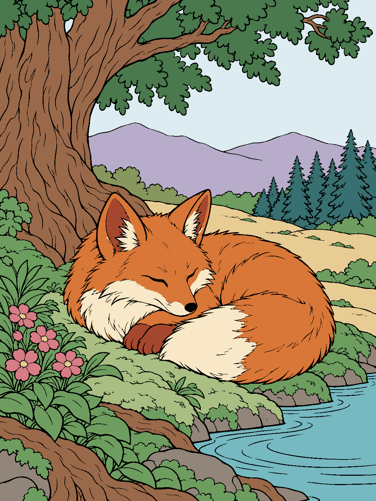

# Coloring — sleeping fox, 15 color layers

This folder contains one accepted artwork and the current instructions for the next account. Read this file first. The old woodland-girl example and the rejected forest-heavy batch are not current examples.

Download [the complete fox package](Fox-15-Layers.zip), extract it, and open `index.html` in a browser. The viewer works offline: isolate any of the 15 colors, switch to black-and-white, or show the complete picture. GitHub's file view displays the HTML source; download it to use the viewer.

| File or folder | Contents |
| --- | --- |
| `index.html` | Portable preview with all 30 layer images embedded |
| `fox-15-colors/colored/` | 15 transparent color PNGs, one unique fill color per layer |
| `fox-15-colors/black-and-white/` | 15 matching transparent PNGs with white fills and black ink |
| `fox-15-colors/assembled-color.png` | The unchanged finished fox picture |
| `fox-15-colors/assembled-black-and-white.png` | The unchanged complete coloring sheet |
| `fox-15-colors/previews/` | Readable overviews of all 15 colored and uncolored layers |
| `fox-15-colors/layers.json` | Names, exact colors, filenames, hashes and old-to-new merge mapping |
| `fox-15-colors/verification.json` | Exact reconstruction, mask and original-art preservation checks |

Every layer uses the same **1086 × 1448** full canvas. Keep all layers at the same size and position. Black linework belongs to these layers and is not a sixteenth color. The equal-color merge changes only the layer grouping: the complete colored and black-and-white images remain byte-identical to the accepted originals.

The ZIP contains this same folder without a nested copy of the ZIP. It includes no old print pack or generated drafts. This is an artwork/reference update only; it does not change the live app, Cloudflare or an application handoff version.

## Current brief for the next account

This document records the user's current expectations. It is a planning and production reference, not an instruction to generate more artwork now. The twenty-scene collection was canceled. Its artwork is not approved and must not be included in the fox delivery or treated as the accepted visual direction. Do not resume that batch automatically.

## Accepted reference and current delivery

The accepted example is the original sleeping fox illustration, “Woodland fox — a quiet moment.” The original bitmap is 1086 × 1448 pixels, portrait 3:4, with fine black storybook contours. Its first export contained twenty layers but only fifteen unique fill colors. The corrected delivery consolidates those repeated colors into **fifteen color layers**; it does not create another illustration.

The original duplicate groups were layers 05/06 (umber), 08/09 (gold), 16/17/18 (one green), and 19/20 (gray). Merging those groups changes twenty layers to fifteen while preserving the same assembled image. Black structural ink does not count as another fill color.

Use the fox as a reference for **linework, drawing quality, and coloring-art finish only**. The useful qualities are graceful confident outlines, attractive closed shapes, natural proportions, understandable object intersections, and a pleasing complete picture. Do not borrow its subject arrangement or automatically add a tree, river, grassy bank, flowers, distant hills, woodland animals, or the same foreground framing.

The fox's existing spatial compromises are not a template for future pieces. New illustrations should plan color ownership carefully before generation so that identical colors can be merged without making a layer feel scattered.

## Variety is a central requirement

Future pictures must differ strongly in **what is depicted, where it is depicted, and how the picture is composed**. A series of different animals placed beside similar trees and rivers does not meet this expectation. Neither does a series of different people in the same garden layout.

The user described a target of roughly **10% shared representations**. Treat this as a qualitative request for very little repetition, not a measurable similarity score or a promise that software can prove “90% different.” Review the subject, setting, viewpoint, framing, major objects and mood together. A shared outline style is welcome; repeated scene ingredients are not the goal.

Subject categories can include contemporary people, city life, ordinary objects, architecture, stark landscapes, animals, imagined worlds, and cultural settings. Stylish real people are one useful category, not the theme for the entire library. A picture does not always need a person or animal. A simple object may be the main subject when its composition is beautiful and supports useful coloring regions.

Examples that illustrate the breadth the user wants:

| Direction | Possible original composition | What makes it different |
|---|---|---|
| Stylish contemporary person | A well-dressed young adult at a striking urban corner | Street architecture, clothing, confident pose; greenery is optional. |
| Everyday street life | A person reading a newspaper at a sidewalk café or on a city bench | A quiet human action and urban objects; no automatic forest background. |
| Bare mountain | An austere mountain ridge with broad rock planes and open sky | Large geological shapes and negative space; trees, rivers and grass are unnecessary. |
| Object still life | An apple on a plate on a thoughtfully arranged tabletop | A close still life with deliberate shape and color relationships. |
| Interior object | A wall clock in an interesting room or architectural niche | Circular geometry, wall planes and a different viewpoint; avoid tiny unreadable numerals. |
| Fantasy | An original impossible room, floating workshop or invented character in a strange setting | New imaginative forms and composition, rather than a familiar franchise or another woodland cottage. |
| Cultural setting | An observed architectural or everyday-life scene informed by reliable references | Specific details should come from research, rather than generic costumes or stereotypes. |

These are examples of variety, not a new approved batch, a required topic list, or permission to produce them now. Do not force every example into the same visual arrangement. If an apparently simple subject cannot support ten meaningful distinct colors, improve its surrounding composition or choose another idea; do not add decorative dots or near-identical shades to reach a count.

## Reference research before future production

For a future authorized batch, research references on **Pexels and Pixabay**, as the user requested. In particular, look for stylish, classy photographs of real men as references for poses and clothing, alongside varied objects, interiors, buildings and landscapes. A suitably licensed photograph can be adapted or transferred into this drawing style; reorganize its colors and composition as useful. Keep the photograph's believable anatomy and object structure. Do not impose the fox's forest arrangement on it.

Keep a small reference log for each proposed picture. Record the exact individual photo or illustration page, not just a search-results URL:

- Direct source-item URL and its title or identifier.
- Creator name and provider (Pexels or Pixabay).
- Exact license name and license/terms URL checked on the date of use.
- Access/check date and a short note describing what was studied, such as coat folds, seated pose, clock construction or mountain forms.
- Whether the reference is used for pose/detail study or as the source of a style transfer, and what is adapted.

Starting points for checking provider terms are the [Pexels license](https://www.pexels.com/license/) and the [Pixabay license summary](https://pixabay.com/service/license-summary/). The summary links to Pixabay's full terms. These pages were checked on October 27, 2026 (America/New_York); recheck the applicable terms when selecting each reference. Record actual permitted use rather than labeling every stock image "copyright-free."

No specific Pexels/Pixabay source item is selected by this brief, and no new reference download or generation is requested now. A later account must supply actual item URLs rather than claim that this planning document already researched a complete image library.

## Color and layer requirements

Each future finished piece should have **10–20 visually distinct solid fill colors**. Use the number the composition naturally supports within that range. Twenty is a maximum, not a target to reach by splitting a color into several layers. The fox's fifteen-color delivery is a useful example of an acceptable count.

**One identical final fill color must belong to one global layer.** If the same hex value occurs in several places, merge those masks. Renaming the color or giving distant parts different layer numbers does not make them different colors. Black contours and small structural details are ink, not an extra student coloring color.

At the same time, plan each color around one object, one coherent background field, or a tight nearby group. Do not reuse a shirt color in a distant building, a foreground flower color in remote treetops, or the same accent in unrelated corners. If equal-color merging produces widely scattered unrelated regions, revise the color plan or source composition; do not hide the problem with duplicate-color layers.

Separated parts of the same nearby subject can be reasonable: a person's face and hands, an animal's broad markings, or several flowers in one bed. Use judgment about the whole semantic group. A layer should feel like one meaningful thing for a child to color, not random fragments distributed across the page.

Colors must look different to a person, not merely have different RGB values. Avoid several almost-identical greens, creams or blues. Prefer deliberate, tasteful separation across the palette. Do not use shading ramps, gradients, grain, watercolor texture, glows or tiny extra highlights as additional colors. Avoid large near-black fills that become confused with the black linework during extraction.

## Drawing and delivery quality

The finished picture should be enjoyable as artwork before it is separated into layers. Keep human and animal anatomy coherent, hands and feet understandable, objects correctly connected, and contours smooth and confident. Avoid warped faces, extra limbs, floating pieces, dense microdetail, arbitrary patchwork and the same decorative filler repeated in every scene.

Use broad enough enclosed regions for practical coloring. Fine structural strokes may explain fur, clothing or an object, but should not create hundreds of nuisance fragments. Prefer portrait 3:4 when appropriate; preserve the source illustration's actual proportions. Every layer of a picture must have the same full canvas and registration, so stacking them recreates the complete picture without stretching or manual positioning.

For a future approved production, deliver the complete colored image, its black-and-white counterpart, transparent full-canvas colored layers, corresponding black-and-white layers, a color/layer manifest, and a readable layer overview or offline preview. Verify the saved layer files reconstruct the assembled image exactly, with no gaps or duplicate pixel ownership. Check every isolated layer visually as well as the complete picture: a successful reconstruction alone does not prove good color grouping or good art.

Before expanding a new direction into a large collection, show a representative finished illustration and its actual layer breakdown for review. Do not resume the canceled collection automatically. The current request is only to preserve this brief and the merged original fox in the repository's Coloring folder. It does not call for more generation, an application handoff version, Cloudflare changes, deployment or changes to student data. Any later external write must follow the active workspace approval rule.
