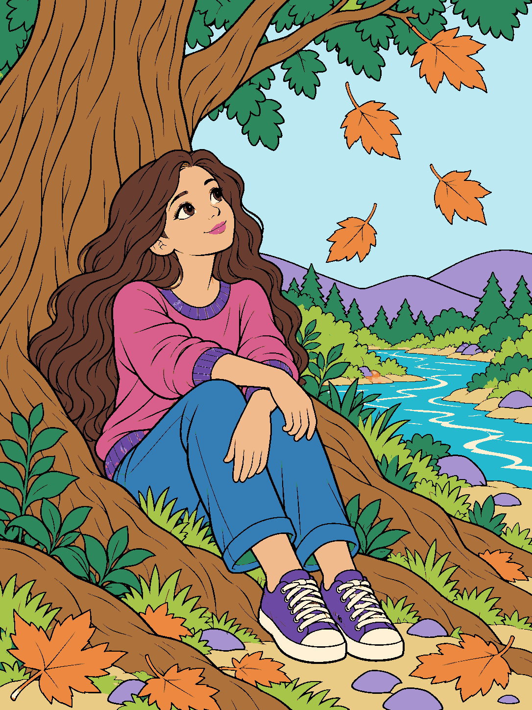

# Coloring

A standalone coloring-layer study for XY Learning Lab. This folder contains **one complete current example**: a girl seated beneath a woodland tree, using **14 distinct fill colors plus black outlines**.

**Open `index.html` in a browser.** It works offline with no installation or build step. Use **Only** to isolate a color layer, switch between colored and black-and-white layers, or show all layers together.



## Current visual direction

- Use an attractive, more mature illustrated coloring-book style for preteens and teens: a graceful face, natural anatomy and hands, flowing wavy hair, and thoughtful clothing and sneaker details.
- Use bold, clean black contours and enjoyable, clearly enclosed coloring spaces. Add woodland plants, bark, grass, leaves, water and landscape details while leaving practical room to color.
- Choose a pretty, imaginative palette whose colors stand apart. The colors do not have to be realistic.
- Use **one solid fill color plus black linework per layer**. A palette color can recur naturally in several separate objects; those objects share its color layer.
- Let the illustration and useful palette determine the layer count. This example uses 14 colors. Future examples can use a different count.
- Preserve the artwork's proportions and contours. Do not inflate hands, slice hair into arbitrary patches, or distort the composition to meet a numeric target.

Earlier requirements for exactly 20 layers, a minimum 1/30-canvas area per layer, and one connected portion per layer were superseded by the later color-based direction. The rejected 20-layer drafts are intentionally not examples in this folder.

## Included example

All example files are in [`examples/woodland-14-colors/`](examples/woodland-14-colors/).

| Item | Purpose |
| --- | --- |
| `colored/` | 14 PNG color layers with transparent backgrounds |
| `black-and-white/` | The same 14 footprints, with white fill areas and black linework |
| `assembled-color.png` | All color layers combined |
| `assembled-black-and-white.png` | The complete uncolored coloring sheet |
| `woodland-color-layer-print-pack.pdf` | 29 US Letter pages: 14 uncolored layers, 14 colored layers, then the assembled picture |
| `layer-key.csv`, `layers.json` | Color names, exact palette values, layer filenames and measured areas |
| `brief-and-palette.json` | Generation brief, palette and design decisions |
| `packaging-verification.json` | Reconstruction, palette, PDF and viewer verification |
| `source/generated-master.png` | The generated master used for the palette separation |
| `extract_color_layers.py`, `build_color_deliverables.py` | Optional local reproduction helpers |

## Alignment and printing

The 28 layer PNGs share the same **1086 × 1448** canvas. Keep each full canvas at the same size and position. The color and uncolored footprints match exactly; the layers cover the image without duplicated masks, overlapping pixels or missing pixels. Combining the color layers reconstructs `assembled-color.png` independently of stacking order.

Print the PDF at **Actual size / 100%**. For physical stacking, use clear film or tracing paper and align the four registration crosses. Ordinary opaque paper is suitable for coloring individual sheets but will hide layers placed beneath it.

## Optional reproduction

The viewer and supplied artwork require no software installation. To rebuild the example files, use a Python environment with the dependencies in `examples/woodland-14-colors/requirements.txt`, then run from this folder:

```sh
python examples/woodland-14-colors/extract_color_layers.py
python examples/woodland-14-colors/build_color_deliverables.py
```

The helpers use paths relative to their own example folder. The extraction helper indexes the existing generated master into the recorded palette; it does not generate new art. The packaging helper can also create a separate example viewer and raster-containing SVG files when rerun. The supplied top-level `index.html` is the portable viewer for this checked-in example.
