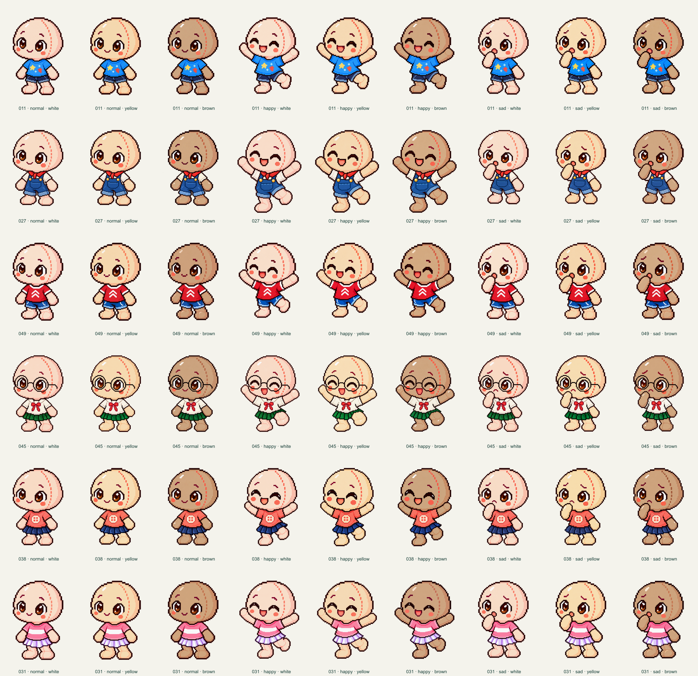
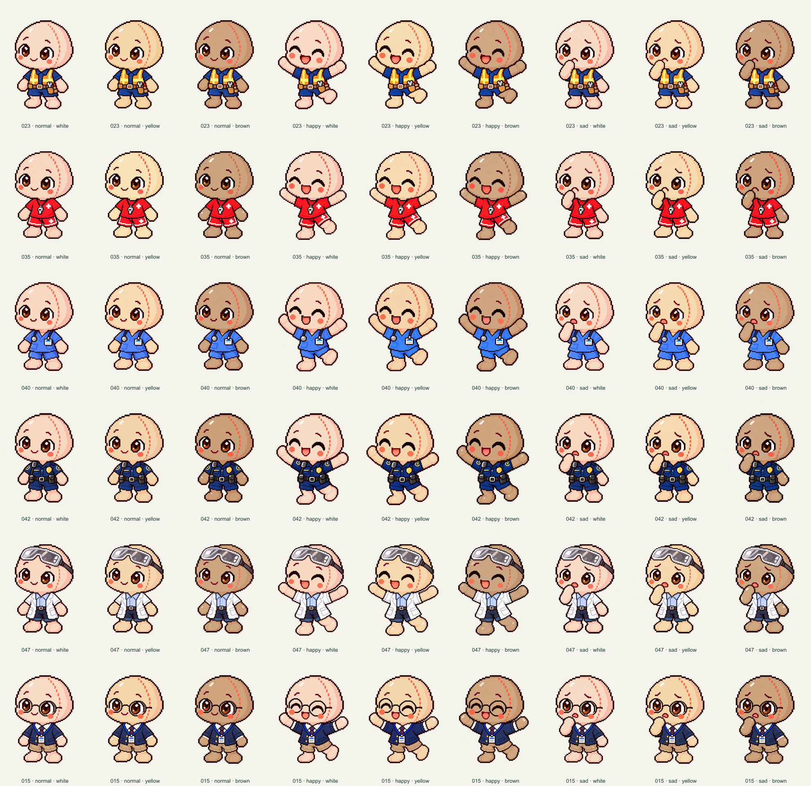
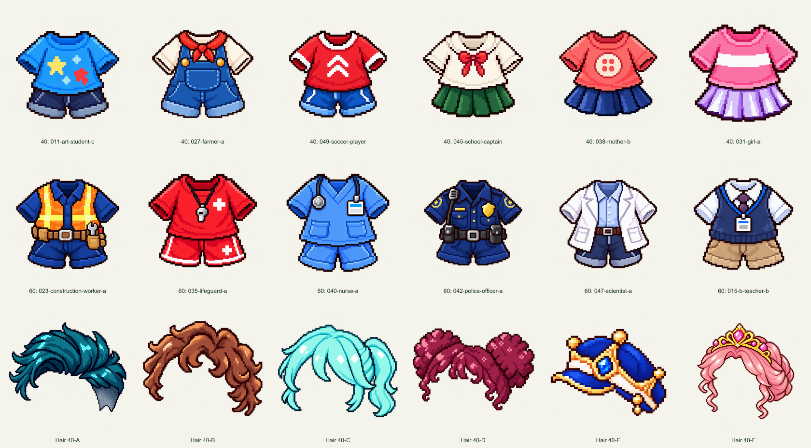

# YY Buddy outfits — local review v4

Prepared 2026-10-23 for an asset-only copy in GitHub's `October 23rd version/` folder. No Cloudflare deployment, live application, student data or online handoff changes.

## Images

- `tier-40/`: 54 newly redrawn complete sprites. Outfits 11, 27, 49, 45, 38 and 31; normal/happy/sad × white/yellow/brown.
- `tier-60/`: 54 newly redrawn complete sprites. Outfits 23, 35, 40, 42, 47 and 15; the same states and tones.
- `headwear/`: the six existing full-canvas premium headwear overlays A–F, retained for fitting and reuse.
- `thumbnails/`: 18 new selection icons — six Tier 40 outfits, six Tier 60 outfits and six Tier 40 headwear items. No buddy/body/skin in the icons.

Full sprites and headwear are transparent 1728 × 2304 PNGs. Selection icons are transparent 260 × 260 PNGs, matching the existing Tier 20 outfit icon canvas. Default icons are 201 × 260; some older Tier 20 hair icons have unusually large square source canvases, so 260 × 260 follows the normalized premium format.

Each new sprite was redrawn as a whole coherent image using the built-in image generation tool, with the earlier complete outfit drawing as a costume reference and the supplied standard YY Buddy as the anatomy reference. Clothes were not cut out and pasted onto a reference body. Skin-tone edits used supplied reference images 51 (cream yellow), 52 (light peach/white) and 53 (medium tan brown).

Final registration changes only the uniform scale and x/y placement of the whole figure. No independent head, shoulder, garment or limb stretching is used. Natural small drawing differences remain between separately generated poses; this is not a claim that every head contour is pixel-identical. The unmodified generated images, prompts and placement measurements are retained beside the delivery folder in the local workspace.

## Headwear animation verification

Read-only inspection of the current live CSS confirms the shared headwear layer uses normal 0 CSS px, happy −1 CSS px and sad +1 CSS px. These are display/CSS pixels. Do not bake these offsets into the full-canvas hair PNGs. Keep the same overlay registered at the same canvas origin, and let the existing renderer apply the state movement.

An explicit one-pixel description was not found in the reviewed Handoff v4–v23 files. The local research report records the existing live CSS evidence. No online handoff was edited.

## Review

The previews show all 54 images per tier, plus all 18 icons. Files are grouped by outfit number, state and tone. `DELIVERY-MANIFEST.json` lists measured image dimensions, alpha/edge checks, sizes and SHA-256 hashes. The local `prompts/` directory contains the exact built-in image generation prompts.

Downloads: [54 Tier 40 PNGs](YY-tier-40-October-23.zip), [54 Tier 60 PNGs](YY-tier-60-October-23.zip), [six full headwear overlays and 18 thumbnails](YY-headwear-and-thumbnails-October-23.zip). These separate archives fit GitHub's individual-file upload limit. The larger combined archive is retained locally.

